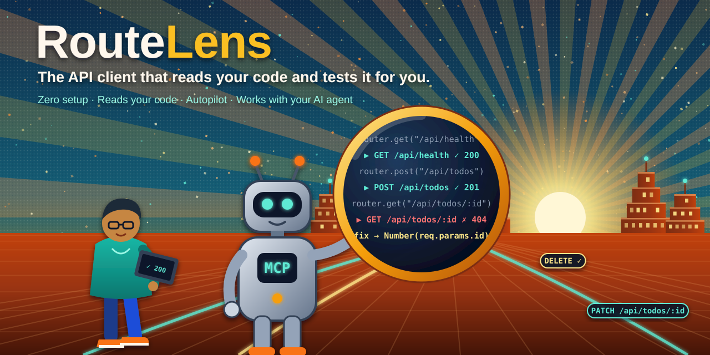
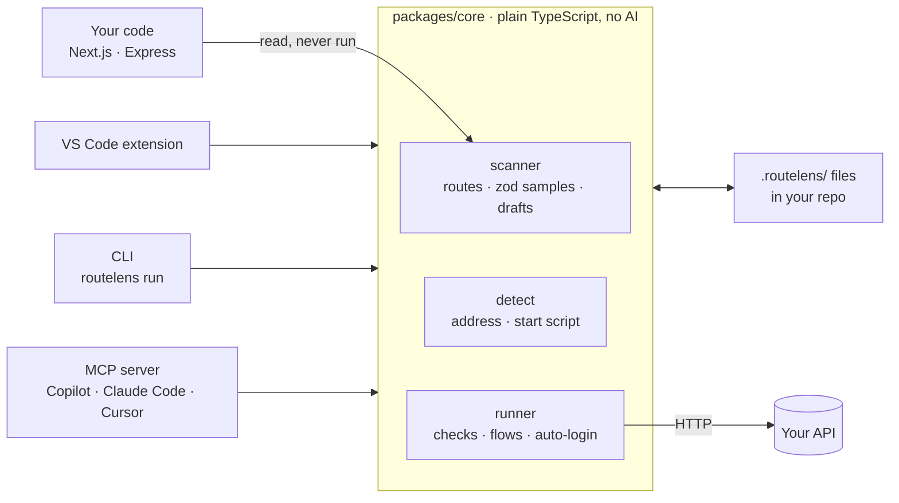

<p align="center">
  
</p>

<p align="center">
  <a href="https://github.com/harshdazz/routelens/actions/workflows/ci.yml"></a>
  <a href="LICENSE"></a>
  
  
  
  
</p>

# RouteLens

**The API client that reads your code and tests it for you.**

RouteLens is a VS Code extension for Next.js and Express developers. It finds your API, writes a request for every route from your code and your zod schemas, runs them for you, and shows the result right above the handler. It also lets the AI agent you already use (Copilot, Claude Code, Cursor) test your API and fix what's broken.

> **Status: pre-alpha.** Milestones M0–M5 are built and tested: core client, zero setup, reads your code, autopilot, and AI agents through MCP. It is not on the VS Code Marketplace yet; that is the v0.1 launch (M6). You can [try it from source](#try-it-from-source) today.

---

## Why RouteLens

With a typical API client you copy URLs from your code, write request bodies by hand, keep them in sync when the code changes, click Send one request at a time, and switch to the terminal and your code when something fails.

RouteLens reads your code instead:

| You would normally…                       | RouteLens…                                                                |
| ----------------------------------------- | ------------------------------------------------------------------------- |
| Find the port and set up a base URL       | Finds your server's address and tells you where it found it               |
| Start the dev server in a terminal        | Offers **▶ Start server** when it's off, then sends again                 |
| Copy every route into the client by hand  | Lists every route from your code, with a **▶ Send** button above each one |
| Write a valid JSON body                   | Builds a sample body from your zod schema that passes that schema         |
| Update requests when the code changes     | Updates them by itself and keeps your edits                               |
| Click Send on each request                | **Test everything** in one click, and runs requests again when you save   |
| Write login code to test protected routes | Logs in once when a route answers 401, and reuses the token               |
| Set up a separate tool for CI             | `routelens run` runs the same files in GitHub Actions                     |
| Paste errors into your AI chat            | Your agent calls RouteLens directly: run all, read the failure, fix it    |

## What it does

### 1. Zero setup

Open a JavaScript project: Next.js, Vite, Express, NestJS or a monorepo. RouteLens finds the API's address from your `dev` script, `.env` or server code, creates a `.routelens/` folder, and says which clue it used: _"Found your API at http://localhost:3000 (from "next dev" in package.json) · Change"_. If the server is off when you send, **▶ Start server** runs your `dev` script in a visible terminal, waits for the port, and sends again.

### 2. Reads your code

A **Routes** sidebar lists every API route in your Next.js (App Router and `pages/api`) or Express project, including routers mounted across files. A **▶ Send** button sits above each handler, with the last result next to it: `✓ 201 Created · 14 ms`. Each route gets a request file with a sample body built from its zod schema. When you change the route, its request follows, and anything you edited is kept. RouteLens reads your code with the TypeScript parser and **never runs it**.

### 3. Autopilot

- **Test everything:** one click runs every request and flow (reads first, deletes last) and shows a health board: `12 passed · 2 failed`.
- **Runs again on save:** save a route file and its requests run again, with the new ✓/✗ above the handler, typically in well under 2 seconds.
- **Checks:** a request passes when its status is below 400, or when the response matches its `expect` block.
- **Flows:** a `.flow.json` file runs requests in order and passes values on ("create a post, then read it back"). Plain code replays it; no AI.
- **Logs in by itself:** when a route answers 401, RouteLens finds your login route, asks for your login once (kept in the OS keychain, never in files) and reuses the token.

### 4. The same tests in CI

```bash
routelens run --start --junit report.xml
```

The CLI (`@routelens/cli`, published with v0.1) runs the same request and flow files: it starts your dev server if asked, writes a JUnit report, and marks failures on the files in GitHub pull requests. See [the example workflow](examples/github-actions/routelens.yml).

### 5. Works with your AI agent

RouteLens ships an [MCP](https://modelcontextprotocol.io) server with 7 tools: `list_routes`, `run_all`, `get_last_failure`, `read_route_source`, `send_request`, `run_flow` and `save_flow`. Ask your agent _"Test my API and fix what's broken"_. It runs everything, reads the failure together with the route's code, and fixes the line. Both Claude Code and Copilot agent mode found and fixed the planted bug in [`fixtures/buggy-api`](fixtures/buggy-api) this way.

- **Copilot agent mode** (VS Code 1.101+): nothing to set up.
- **Claude Code and Cursor:** one click with **RouteLens: Connect an AI Agent**.

The guard rails stay on whatever the AI decides: requests only go to this machine or to hosts in your environment files, and writes to other hosts need your OK. Read more in [Using RouteLens with AI agents](docs/using-with-ai-agents.md).

## How it works



One core, three front ends. The editor, the CLI and the AI agent all use the same runner, so they always agree on what "passed" means. AI never decides a test result: agents write requests and flows, and plain code replays them ([ADR-0004](docs/decisions/0004-ai-writes-once-replay-deterministic.md)).

## Your requests are files in your repo

Everything lives in `.routelens/`, as JSON you can review in pull requests ([ADR-0003](docs/decisions/0003-request-file-format.md)).

A request (`.routelens/requests/create-post.req.json`):

```json
{
  "version": 1,
  "name": "Create post",
  "method": "POST",
  "url": "{{baseUrl}}/api/posts",
  "body": { "type": "json", "content": { "title": "Hello" } },
  "expect": { "status": 201, "values": { "body.id": { "type": "number" } } }
}
```

A flow (`.routelens/flows/create-and-read-post.flow.json`):

```json
{
  "version": 1,
  "name": "Create a post and read it back",
  "steps": [
    { "request": "create-post", "extract": { "postId": "body.id" }, "expect": { "status": 201 } },
    {
      "request": { "method": "GET", "url": "{{baseUrl}}/api/posts/{{postId}}" },
      "expect": { "status": 200, "values": { "body.id": "{{postId}}" } }
    }
  ]
}
```

The editor autocompletes these files from their JSON schemas. Environments (`.routelens/environments/local.env.json`) hold non-secret values like `baseUrl`; secrets never go in these files.

## Try it from source

Requirements: Node.js 20+, [pnpm](https://pnpm.io) 10, VS Code.

```bash
git clone https://github.com/harshdazz/routelens.git
cd routelens
pnpm install
pnpm check          # format, lint, typecheck, tests, build
```

**In VS Code (development window):**

1. Start the demo API with `pnpm demo-server` (http://localhost:4000).
2. Open the `routelens` folder in VS Code and press **F5**. A second window opens with the `examples/` folder.
3. Open the **RouteLens** sidebar and click **▶▶ Test everything**. When asked to log in, use `demo@routelens.dev` / `demo-password`.

**As an installed extension** (needed for Copilot agent mode, which the F5 window turns off):

```bash
pnpm build
pnpm --filter routelens package
code --install-extension packages/vscode/routelens-0.0.1.vsix
```

**The CLI** (with the demo server running):

```bash
node packages/cli/dist/cli.js run examples
```

**See an AI agent find a bug:** copy `fixtures/buggy-api` to a folder such as `todo-api`, run `npm ci` and `node --watch src/server.js` there, open it in VS Code, run **RouteLens: Connect an AI Agent**, and ask your agent _"Test my API and fix what's broken"_.

## Safety and privacy

- **Reads code, never runs it.** Route scanning uses the TypeScript parser on files inside the workspace only.
- **Starting your server** happens only in trusted workspaces, only with the `dev` / `start` script from `package.json`, always in a visible terminal, and the first start in each workspace needs your click.
- **Secrets stay out of your repo.** Logins live in VS Code's SecretStorage (the OS keychain) and tokens only in memory. A token is only sent back to the server that issued it.
- **AI agents get guard rails:** only this machine or hosts from your environment files; `POST`/`PUT`/`PATCH`/`DELETE` to another machine need your OK; no server starts; no passwords through the agent.
- **No telemetry.** RouteLens sends nothing anywhere except the requests you, or your agent, run.

## Project layout

```
packages/core     editor-independent logic: model, variables, HTTP engine, storage,
                  detect, scanner (routes, zod samples, drafts), runner (checks, flows, login)
packages/vscode   the VS Code extension
packages/cli      routelens run, for the terminal and CI
packages/mcp      the MCP server AI agents use (routelens-mcp)
examples/         sample requests, a flow, environments, a demo server, a GitHub Actions workflow
fixtures/         small projects for the detection, scanner and acceptance tests
docs/             lifecycle plan, product spec, architecture, roadmap, decisions (ADRs)
```

**Tech:** TypeScript (strict), pnpm workspaces, zod, the TypeScript compiler API (parser only), Node's fetch, esbuild, Vitest, `@vscode/test-electron`, `@modelcontextprotocol/sdk`.

**Tests:** about 380 unit and integration tests, 17 end-to-end tests in a real VS Code, and acceptance checks on fresh installs of real fixture projects (run by hand). CI runs the unit, integration and end-to-end tests on every push and pull request, plus the CLI against the demo server.

## Engineering highlights

- **Static analysis instead of execution:** routes are found by following imports, exports and router mounts across files with the TypeScript parser ([ADR-0007](docs/decisions/0007-route-scanner-static-parsing.md)).
- **Sample bodies that pass your schema:** a small interpreter turns zod schemas into sample values, and tests check every sample against the real zod.
- **Requests that follow the code without losing edits:** each value RouteLens writes carries a fingerprint, so it updates only what you haven't changed.
- **One runner, three front ends:** the editor, the CLI and the MCP server share the same checks, flows and auto-login ([ADR-0008](docs/decisions/0008-autopilot-runner-flows-login.md)).
- **Safe AI tooling:** every outgoing request passes a guard that the agent can't turn off, and writes to other machines ask the person through MCP elicitation ([ADR-0009](docs/decisions/0009-mcp-server-for-ai-agents.md)).

## Roadmap

| Milestone                   | Status                                                 |
| --------------------------- | ------------------------------------------------------ |
| M0 Foundation               | ✅ done                                                |
| M1 Core client              | ✅ done                                                |
| M2 Zero setup               | ✅ done                                                |
| M3 Reads your code          | ✅ done                                                |
| M4 Autopilot                | 🟡 built and tried by hand; waits for its first CI run |
| M5 Works with your AI agent | ✅ done (Claude Code and Copilot checked)              |
| M6 Launch v0.1              | ⏳ next: Marketplace, Open VSX, npm, demo              |
| M7 Built-in AI brain (v0.2) | planned                                                |
| M8 Essentials (v0.3)        | planned                                                |

Details and dates are in the [roadmap](docs/03-roadmap.md).

## Docs

- [Using RouteLens with AI agents](docs/using-with-ai-agents.md)
- [Product spec](docs/01-product-spec.md)
- [Architecture](docs/02-architecture.md)
- [Roadmap](docs/03-roadmap.md)
- [Engineering lifecycle plan](docs/00-lifecycle-plan.md)
- [Architecture decisions (ADRs)](docs/decisions/)

## Contributing

Issues and ideas are welcome. See [CONTRIBUTING.md](CONTRIBUTING.md) for the setup, the checks to run and the conventions. To report a security problem, see [SECURITY.md](SECURITY.md).

## License

[MIT](LICENSE) © 2026 Harsh Dubey
